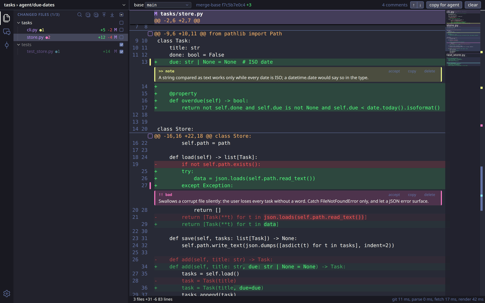
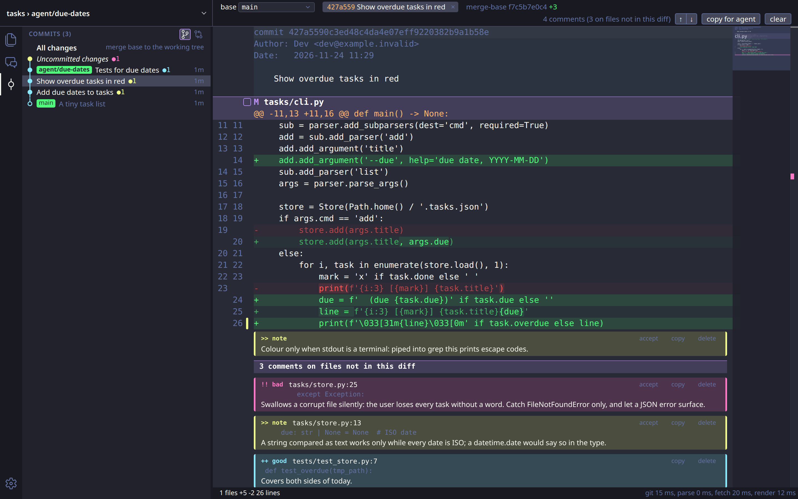

# gitr

A Git diff viewer for reviewing what coding agents changed. It opens your
branch's whole change against a base as one continuous diff in a browser
window, with a file list, review comments the agent can read back, viewed
marks, and the branch's commits. Everything stays in the repository: no
account, no cloud service, no internet needed.



- **One diff for the whole review**: every changed file in one scrolling
  view, word-level highlights on edited lines, re-indented lines collapsed.
- **Comments an agent can act on**: comment any line as a note, bad or
  good; `gitr export` (or "copy for agent") turns them into a message
  for the agent, and `gitr comments` lets an agent or a script read and
  write them too. They follow their lines as the code changes.
- **Keep up with the agent**: the page notices when the worktree changes,
  and after a reload marks what is new since you last looked.
- **Viewed marks** per file and hunk; a hunk the agent changes comes back
  unviewed.
- **Commits pane**: the branch as a graph, any commit or range on its own,
  and per commit how many comments its lines carry.
- **Server mode** (`gitr serve`): one page for many repositories and all
  their worktrees, one per agent, running where the agents run and
  reachable over SSH or Tailscale. It pairs well with
  [herdr](https://herdr.dev), which runs the agents themselves: herdr for
  driving them, gitr for reviewing what they changed.

## Install

```bash
uv tool install gitr      # or: pipx install gitr
```

It needs Python 3.10+, git, and a browser; nothing else (the page's
editor, Monaco, comes bundled). A Chromium-family browser (Chrome,
Chromium, Edge, Brave, Vivaldi, Opera) gives it a window of its own;
with others it opens in a tab.

## Quick start

```bash
cd my-repo
gitr                      # review this worktree against main / master
gitr develop              # ... against another base
```

A typical round with an agent working in a worktree:

1. Run `gitr` in the worktree and read through the diff.
2. Comment on lines: hover the gutter and click `+`, or right-click a line
   for one-click presets. Mark files viewed as you go.
3. Hand the comments to the agent: "copy for agent" in the top bar, or let
   the agent run `gitr export` itself.
4. When the agent has made changes, the page says so; reload, and what
   changed since is marked, so you review only the follow-up.

### Many agents at once

When several agents work in parallel, each in a worktree of its own (and
perhaps on another machine), run the server instead, where the
repositories are:

```bash
gitr serve ~/dev/my-repo ~/dev/other-repo   # then open http://127.0.0.1:4487/
```

Or list them once in a config file, and plain `gitr serve` serves them:

```bash
mkdir -p ~/.config/gitr
gitr serve --print-config ~/dev/my-repo ~/dev/other-repo > ~/.config/gitr/projects.json
gitr serve
```

The page lists every worktree of those repositories; switch between them
from the top left (or Ctrl+P), each keeping its own base, comments,
viewed marks and scroll position, and each telling you when its agent has
changed something. The config can also list a directory of checkouts, and
the page can be installed as an app; see [`gitr serve`](#gitr-serve).

This is where [herdr](https://herdr.dev) fits in: herdr runs the agents
(a pane each, their state at a glance, sessions that survive a dropped
connection), and `gitr serve` on the same machine shows what each of them
changed, for you to review and comment on, and for the agents to read
back with `gitr export`.



## Usage

```bash
gitr                         # this repository's review in a window
gitr master                  # ... against master
gitr -- comments             # a base named like one of gitr's commands
gitr --browser list          # the browsers gitr found, the one it uses marked
gitr --browser vivaldi       # that one (a listed name, or a path)
gitr --browser default       # a tab in the default browser
gitr --browser none          # only print the address
```

`GITR_BROWSER` takes the same values, for a choice that sticks; `--browser`
wins over it.

`gitr` serves the repository it is run in and opens it in a Chromium-family
browser's app mode: a window of its own, in a browser profile of gitr's
own, apart from your browsing. Without such a browser it opens a tab in
the default one. The base is the one last used for the worktree, else
`main` or `master`.

It runs until Ctrl+C or until its last window closes. Running it again in
the same repository opens another window on the running one; over ssh it
prints the address instead.

## Comments from the command line

The review comments (in `.gitr/review.json` of the repository) can be read
and written from the terminal, so an agent or a script can take part in a
review:

```bash
gitr export master                       # all comments as markdown for an agent
gitr export --kinds bad,note master      # only these kinds
gitr export -p change.diff               # placed on a patch (- for stdin)
gitr comments list [--kinds bad] [src/]  # one line each: id, path:line, kind, text
gitr comments list --full                # with the whole texts (--json for scripts)
gitr comments add src/foo.py:42 "this leaks the handle" --kind bad
gitr comments add src/foo.py:42 - < note.txt   # the text from stdin
gitr comments accept 3f9a2c1             # resolved: a good comment ending in "(accepted)"
gitr comments rm src/foo.py:42           # by id (any unique prefix) or path:line
```

A comment from `add` goes on that line of the file as it is in the working
tree, with no diff involved: the page shows it on that line whether their
diff has it added or unchanged (a line outside every hunk is listed after
the diff). `list` gives the lines as they are now, flagged when a line's
text changed, its file is gone, or it is a removed line (a comment from the
page). A line takes one comment from `add`; remove the old one first, or
edit it in the page.

Keep `.gitr/` out of commits (e.g. in a global gitignore), or agents may
commit it.

## gitr serve

`gitr serve` is the same page for several repositories and all their
worktrees. It runs where the repositories are (e.g. a remote machine with
agents working in worktrees), in the foreground.

```bash
gitr serve ~/dev/repo-a ~/dev/repo-b         # these repos, on http://127.0.0.1:4487/
gitr serve                                   # the repos in ~/.config/gitr/projects.json
```

With no repository arguments the list is read from
`~/.config/gitr/projects.json`:

```json
{"projects": ["~/dev/repo-a", {"path": "~/dev/repo-b", "name": "b"}]}
```

`gitr serve --print-config [repo ...]` prints one for the repos given (or
the one you are in), ready to redirect into that file; then plain
`gitr serve` serves them, and with `--reload` picks up changes to the file.

A directory that is not a git repo but holds several (a workspace with one
checkout per service, say) is listed with each checkout under it, picked
up afresh with every listing, when its entry says so:

```json
{"projects": [{"path": "~/dev/workspace", "multi": true}]}
```

Only the checkouts directly in it are found; `"depth": 2` looks one level
further down (never inside a checkout).

### From another machine

The server listens on localhost only and has no authentication, so reach it
from another machine through SSH or Tailscale rather than exposing the port.
Plain http to a remote address is not enough either way: browsers allow the
clipboard (the copy buttons) and app install only over https or on localhost.

Through an SSH tunnel the page is on localhost:

```bash
ssh -N -L 4487:127.0.0.1:4487 remote-host    # then open http://127.0.0.1:4487/
```

(or `LocalForward 4487 127.0.0.1:4487` for that host in `~/.ssh/config`).

With Tailscale, `tailscale serve` puts it on https with a real certificate,
for your tailnet only. On the remote machine:

```bash
tailscale serve --bg --https 4487 4487
gitr serve --allow-host remote-host.your-tailnet.ts.net
# then open https://remote-host.your-tailnet.ts.net:4487/
```

The same port number as the server's own does not clash with it: Tailscale
listens on the tailnet address, `gitr serve` on 127.0.0.1. A port of its own
also leaves the default one (443) to whatever else the machine serves;
`tailscale serve --bg 4487` would take it over. `tailscale serve
status` shows what is served where. The allowed name does not depend on the
port.

`--allow-host` names the address the browser uses: the server refuses other
names, so that a web page cannot reach it by pointing its own name at
127.0.0.1. It can be given several times, and the names can be kept in
`projects.json` instead (they apply also when the repos are given on the
command line):

```json
{"projects": ["~/dev/repo-a"], "allow_hosts": ["remote-host.your-tailnet.ts.net"]}
```

`--print-config` fills in the machine's tailnet name when Tailscale runs
there (`tailscale status --json` shows it as `Self.DNSName`).

Chrome can install the page as an app with its own window (the install icon
in the address bar, or menu > Cast, save and share > Install page). The app
belongs to the address it was installed from, port included, so keep the
tunnel on the same local port. To install apps from two machines, reach them
on different local ports (e.g. `ssh -L 4488:127.0.0.1:4487 remote-host` for
the remote one) or one of them through Tailscale; each app is named after its
server's hostname.

## Development

From a checkout, without installing: `python3 gitr_web/server.py`, with
`--reload` to restart on changes to `gitr_web/server.py`, `gitr.py` or
`~/.config/gitr/projects.json`. The page files under `gitr_web/static/` are
read from disk on every request, so changes to them only need a browser
refresh. Tests: `uv run pytest` (or `python3 -m unittest discover -s tests
-t .`). The Monaco bundle under `gitr_web/static/monaco/` is built and
committed; to move to another Monaco version, change it in
`monaco/package.json` and run `cd monaco && npm install && npm run build`
(Node is needed for that only).

## License

MIT, see [LICENSE](https://github.com/trozen/gitr/blob/master/LICENSE). Bundled: [Monaco Editor](https://github.com/microsoft/monaco-editor)
(MIT) and [Codicons](https://github.com/microsoft/vscode-codicons) by
Microsoft, licensed under [CC BY 4.0](https://creativecommons.org/licenses/by/4.0/).
